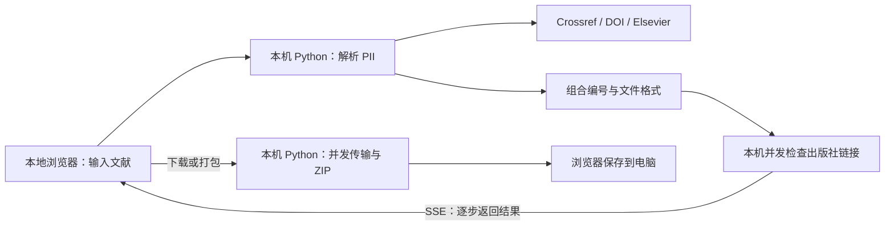

# Elsevier Supplement Finder

**爱思唯尔补充材料查找 · 微光本地版**

穷举之中，自有奇迹！

输入文章标题、DOI、ScienceDirect 链接或 PII，在自己的电脑上查找论文的补充材料。点击文件名打开出版社地址，点击下载保存文件，多份材料可以一键打包。


## 快速开始：Python

需要 **Python 3.11 或更新版本**。全部使用 Python 标准库，**不用 `pip install`，不用 Node.js**。

```bash
git clone https://github.com/hututu001/elsevier-supplement-finder.git
cd elsevier-supplement-finder
python app.py
```

浏览器会自动打开 **http://127.0.0.1:13006/**。保持终端运行，使用完后按 `Ctrl+C` 退出。

Windows 可以使用 `py -3 app.py`，也可以下载仓库 ZIP，解压后双击 `start-windows.bat`。macOS / Linux 如果没有 `python` 命令，使用 `python3 app.py`。

端口被占用或不需要自动打开浏览器时：

```bash
python app.py --port 13007 --no-browser
```

## 使用 Docker

电脑已安装并启动 Docker 时，在项目目录运行：

```bash
docker compose up -d --build
```

然后打开 **http://127.0.0.1:13006/**。镜像构建只需 Python 基础镜像，不下载 Python 或前端依赖。端口仅映射到本机回环地址。

```bash
docker compose logs --tail=50
docker compose down
```

也可以不使用 Compose：

```bash
docker build -t elsevier-supplement-finder .
docker run --rm --init -p 127.0.0.1:13006:13006 elsevier-supplement-finder
```

容器中的临时文件会随着容器删除而消失，浏览器已经保存到电脑上的文件不受影响。Docker 运行和 Python 直接运行提供相同的功能。

## 怎么使用

1. 输入完整文章标题、DOI、ScienceDirect 链接，或者 `S0017931026010112` 这样的 PII。
2. **点击“查找”或按 Enter**，识别文献后自动检查补充材料，不需要再点一次搜索。
3. 检查结果逐步出现。点击材料名称打开出版社链接，点击旁边的“下载”保存文件。
4. 找到多份材料后，文件列表上方显示“一键打包”。下载和打包期间显示进度、已完成数量、数据量与平均速度。

需要扩大范围时展开“检索设置”，修改附件编号、文件类型和检查并发。默认检查 **mmc1–mmc11 × 15 种格式 = 165 个候选**。

- 默认开启：PDF、DOC、DOCX、XLS、XLSX、PPT、PPTX、CSV、ZIP、MP4、MOV、JPG、TIF、PNG、GIF。
- JPEG、TIFF 支持，但默认关闭；它们与 JPG、TIF 分别构造不同链接。
- 附件编号范围 1–100，检查并发默认 32，可设为 1–88。
- 文件列表默认显示 6 份，可展开；超过 12 份时提供格式筛选。
- 未确认链接单独折叠显示，不当作已找到的文件。
- “停止检查”保留页面上的结果；“继续检查”复用当前程序的有效缓存；“重新检查”跳过缓存。
- 新查询开始时清空旧文献信息和结果；查找失败不会继续显示上一篇。

## 查找原理

### 1. 先找到文章的 PII

PII 是 ScienceDirect 使用的文章标识。解析流程沿用原项目：

1. 输入已经包含 PII 时直接提取，兼容链接、URL 编码、带连字符的旧格式和末尾 `X`。
2. 输入 DOI 时查询 Crossref 的公开书目信息，从 `alternative-id`、`resource.primary.URL` 和文献链接中提取 PII。
3. 没有取得 PII 时，检查 DOI 和 Elsevier Linking Hub 的跳转，以及出版社页面的正式文献标识。
4. 输入标题时，使用 Crossref 检索并核对标题。仅接受规范化后一致的标题；多个匹配指向不同文献时提示补充 DOI 或链接，不随意选第一条。

单次解析有 45 秒总预算，单个请求最多等待 8 秒。公开书目信息不完整、出版社验证或当前网络异常时，解析可能失败；可以改用文章的 ScienceDirect 链接或 PII。

### 2. 组合补充材料地址

对于 PII、编号和扩展名的组合，构造：

```text
https://ars.els-cdn.com/content/image/1-s2.0-{PII}-mmc{编号}.{扩展名}
```

例如：

```text
https://ars.els-cdn.com/content/image/1-s2.0-S0017931026010112-mmc1.docx
```

程序发送 `Range: bytes=0-1023`，最多读取前 1 KiB 来检查响应，不在查找阶段下载完整附件。HTTP 200 / 206 且内容像文件时记为可用；404 / 410 记为不存在；超时、403、429、网页验证等记为未确认。

编号和格式的排列组合是这套方法的核心，因此无法保证找全，也无法仅凭文件地址证明材料内容与文章完全对应。它不覆盖其他出版社或使用不同命名方式的附件。

### 3. SSE 实时显示结果



页面通过一条 SSE 流接收文献信息和检查结果，不反复刷新整页。最多同时接受 3 次查询，所有查询共享 88 路附件检查上限；单次并发由检索设置控制。页面关闭或停止检查后，不再补交后续候选，已经发出的网络请求在超时范围内结束。

### 4. 下载与 ZIP 在本机完成

**“Python 服务”就是你电脑上启动的这个程序，文件不经过作者的远端服务器。**

- 每个任务最多 3 个文件并发传输；同时最多 2 个下载任务。
- 文件达到 8 MiB 且出版社提供可用的版本标识时，使用 **4 路 Range 分片并发**。
- 分片核对 `Content-Range` 和实际长度，并使用 `If-Range` 防止拼接不同版本；网络错误有限重试。
- 不支持分片或版本已经改变时，回退到完整文件传输；没有可靠版本标识时使用单路传输。
- 数据分块写入临时文件，不把整个附件或 ZIP 堆在浏览器内存中。多文件下载完成后用标准库生成 ZIP，并交给浏览器保存。
- ZIP 使用存储模式，减少对 PDF、Office、图片和视频的重复压缩开销。
- 下载失败不会生成“成功”的 ZIP；可取消、重试，进度连接中断时可重新连接到同一任务。
- 每次最多打包 100 份，单文件上限 2 GiB，任务合计上限 8 GiB。临时目录需要容纳下载文件与最终 ZIP；磁盘不足时可逐个下载。

这不是 aria2，也不需要浏览器扩展。浏览器同源策略由本地同源接口解决：网页请求自己的 Python 程序，再由本机程序向固定的出版社地址请求文件。

## 网络与代理

程序默认使用当前网络，并支持标准 `HTTP_PROXY` / `HTTPS_PROXY` / `NO_PROXY` 环境变量。没有把任何代理地址或登录信息写进项目。

Python 用户可在启动前配置自己实际可用的 **HTTP 代理**。以下地址仅为示例，请替换端口：

```powershell
# Windows PowerShell
$env:HTTPS_PROXY = "http://127.0.0.1:7890"
$env:HTTP_PROXY = $env:HTTPS_PROXY
$env:NO_PROXY = "localhost,127.0.0.1,::1"
python app.py
```

```bash
# macOS / Linux
HTTPS_PROXY=http://127.0.0.1:7890 HTTP_PROXY=http://127.0.0.1:7890 NO_PROXY=localhost,127.0.0.1,::1 python3 app.py
```

Docker Compose 用户可以复制 `.env.example` 为 `.env` 再填写代理。Docker Desktop 访问宿主机代理通常使用 `http://host.docker.internal:端口`，不是容器内的 `127.0.0.1`；Linux 则需要配置容器实际可达的地址。代理程序也需要允许来自容器的连接。标准库不直接支持 `socks5://`，请使用代理软件提供的 HTTP 入口。

## 数据与资源

- 不连接研通助手 SaaS，不需要 Cookie 或 API Key，不存储账号和查询历史。
- 标题、DOI 等查询内容会发送给上述公开书目／出版社服务，这是文献识别所需。
- 页面结果只在当前页保留；浏览器仅记住检索参数和主题。刷新后输入框清空。
- 已确认和不存在的链接在程序内存中缓存最多 24 小时、最多 8192 项；不缓存未确认状态，程序退出即消失。
- 下载临时文件保存在系统临时目录中，正常退出或任务结束 1 小时后清理。强制结束 Python 可能留下 `elsevier-supplements-*` 临时目录。
- 前端是本地 HTML / CSS / JavaScript 和 SVG，不加载远端字体、JS CDN、统计脚本。全部运行时静态资源约 50 KB，不需要前端构建。

这是面向本机个人使用的工具，默认只监听 `127.0.0.1`，没有登录系统。Docker 的 `0.0.0.0` 仅用于容器内监听，示例端口仍只向本机开放。

## 开发与测试

```bash
python -m unittest discover -s tests -v
node --check static/app.js  # 可选：只做 JS 语法检查，运行程序不需要 Node
```

测试使用模拟出版社响应，不依赖真实附件是否在线。覆盖 PII／DOI／标题解析、模糊匹配、缓存更新竞争、SSE、受限请求、Range 分片、版本变化回退、文件完整性、ZIP、取消与浏览器续传。GitHub Actions 在 Windows / Linux、Python 3.11 / 3.12 下运行测试，并构建 Docker 镜像进行 HTTP 启动检查。

```text
app.py                 启动入口
finder/identity.py     DOI / 标题 / 链接 -> PII
finder/search.py       并发小范围检查、内存缓存、SSE 事件
finder/downloads.py    本机下载任务、分片、ZIP、临时文件清理
finder/server.py       本地网页与 API
static/                无构建前端和 SVG 背景
tests/                 自动化测试
```

文献识别流程和 SVG 视觉资源来自作者的 [研通助手项目](https://github.com/hututu001/ablesci-sign-server-saas)，独立版不包含其中的账号、订单、积分、托管或运营配置。

## License

[MIT](LICENSE)。软件许可证不改变出版社材料的使用条款。仅供学习研究，请自行核对材料正确性与完整性。
