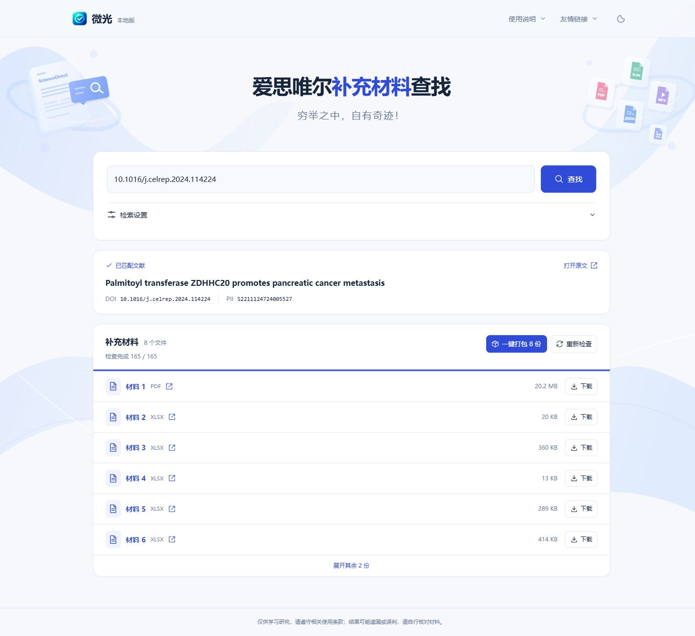

<h1 align="center">Elsevier Supplement Finder</h1>
<p align="center">爱思唯尔补充材料查找 · 微光本地版</p>
<p align="center">穷举之中，自有奇迹！</p>

输入文章标题、DOI、ScienceDirect 链接或 PII，查找补充材料，支持单文件下载和多文件 ZIP 打包。在本机启动，用浏览器操作。

<p align="center">
  
</p>

## 快速开始

### Python

需要 **Python 3.11+**，依赖均来自 Python 标准库。

```bash
git clone https://github.com/hututu001/elsevier-supplement-finder.git
cd elsevier-supplement-finder
python app.py
```

浏览器自动打开 `http://127.0.0.1:13006/`。默认端口不可用时，程序会自动选择空闲端口，实际地址显示在终端中。使用完后按 `Ctrl+C` 退出。

- **Windows**：下载仓库 ZIP 并解压，双击 `start-windows.bat`；也可执行 `py -3 app.py`。
- **macOS / Linux**：执行 `python3 app.py`。
- **指定端口**：执行 `python app.py --port 13007`。加上 `--no-browser` 可手动打开网页。

### Docker

在项目目录运行：

```bash
docker compose up -d --build
```

打开 [http://127.0.0.1:13006/](http://127.0.0.1:13006/)。默认端口映射到本机回环地址。

```bash
docker compose logs --tail=50  # 查看日志
docker compose down           # 停止服务
```

## 使用

1. 输入标题、DOI、ScienceDirect 链接或 PII，点击“查找”或按 Enter。
2. 文献识别成功后，自动检查材料，结果实时显示。
3. 点击文件名打开出版社链接，点击“下载”保存文件；多份材料可“一键打包”。

“检索设置”可调整附件编号、文件类型和并发数。默认检查 **mmc1–mmc11 × 15 种格式，共 165 个候选**，并发为 **32**。

| 设置 | 范围 |
| --- | --- |
| 附件编号 | 1–100 |
| 检查并发 | 1–88 |
| 默认格式 | PDF、DOC、DOCX、XLS、XLSX、PPT、PPTX、CSV、ZIP、MP4、MOV、JPG、TIF、PNG、GIF |
| 可选格式 | JPEG、TIFF |

材料列表默认显示 6 份，支持展开；超过 12 份时提供格式筛选。未确认的链接单独收起。“继续检查”复用有效缓存，“重新检查”重新请求出版社。

## 原理与接口来源

**文献检索直接使用现成的 [Crossref REST API](https://api.crossref.org/)** 获取书目信息，再结合 [DOI](https://doi.org/) 和 Elsevier 的文献链接解析 PII。补充材料使用 Elsevier 的公开文件地址进行检查和下载。

| 环节 | 来源与处理 |
| --- | --- |
| 标题 / DOI 检索 | Crossref `/works?query.bibliographic=…`、`/works/{doi}`；核对标题，读取书目中的 PII 和出版社链接 |
| PII 解析 | 优先提取输入中的 PII，其次检查书目信息、DOI / Elsevier Linking Hub 跳转和出版社页面标识 |
| 材料查找 | 将 PII、附件编号和扩展名组合为候选地址，逐个检查 |
| 下载 / 打包 | 本机 Python 并发下载，完成后生成 ZIP，由浏览器保存 |

候选地址格式：

```text
https://ars.els-cdn.com/content/image/1-s2.0-{PII}-mmc{编号}.{扩展名}
```

检查时请求前 1 KiB 内容，根据 HTTP 状态和响应内容判断文件是否可用。文献信息、进度和结果通过 **SSE** 实时返回网页。编号与格式的穷举是这套方法的核心，结果可能遗漏或误判，请结合论文原文核对。

下载支持多文件并发；文件达到 8 MiB 且出版社支持可靠的 Range 请求时，启用 **4 路分片下载**。打包过程中显示数量、进度和速度。

## 网络与运行数据

查询和下载使用运行程序的电脑或容器网络。程序支持 `HTTP_PROXY`、`HTTPS_PROXY`、`NO_PROXY` 环境变量，可按需设置 HTTP 代理。

<details>
<summary>代理配置示例</summary>

Windows PowerShell（将地址替换为自己的 HTTP 代理）：

```powershell
$env:HTTPS_PROXY = "http://127.0.0.1:7890"
$env:HTTP_PROXY = $env:HTTPS_PROXY
$env:NO_PROXY = "localhost,127.0.0.1,::1"
python app.py
```

macOS / Linux：

```bash
HTTPS_PROXY=http://127.0.0.1:7890 HTTP_PROXY=http://127.0.0.1:7890 NO_PROXY=localhost,127.0.0.1,::1 python3 app.py
```

Docker Compose：复制 `.env.example` 为 `.env` 并填写代理地址。Docker Desktop 访问宿主机代理可使用 `http://host.docker.internal:端口`；Linux 请填写容器可达的地址。

</details>

查询内容会发送给对应书目或出版社服务。页面结果保留在当前页面，浏览器记住检索设置与主题；链接检查缓存保留在进程内存中，最长 24 小时。下载文件存放在系统临时目录，任务结束 1 小时后或程序正常退出时清理。

## 开发

```bash
python -m unittest discover -s tests -v
```

测试覆盖文献识别、候选检查、缓存、SSE、本地请求校验、分片下载、ZIP 和取消流程。GitHub Actions 在 Windows / Linux、Python 3.11 / 3.12 / 3.14 下运行测试，并验证 Docker 启动。

## License

[MIT](LICENSE)。仅供学习研究；出版社材料的使用遵循其相应条款。
